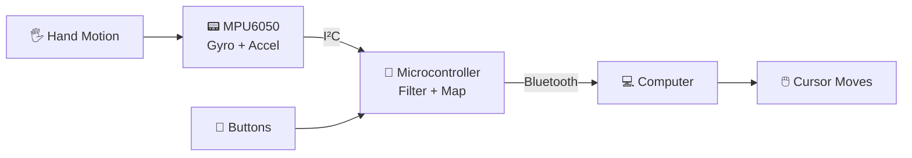

<div align="center">

# 🖱️ AIR MOUSE

### Control your cursor with a wave of your hand. No surface needed.


<br>


<br>

<!-- 🎥 Replace with your demo GIF: drag it into the repo and update the path -->


</div>

---

## 📌 Table of Contents

- [✨ Overview](#-overview)
- [🎯 Features](#-features)
- [🧰 Hardware Required](#-hardware-required)
- [🔌 Circuit & Wiring](#-circuit--wiring)
- [⚙️ How It Works](#️-how-it-works)
- [🚀 Getting Started](#-getting-started)
- [🎮 Controls](#-controls)
- [🧠 Challenges & Learnings](#-challenges--learnings)
- [🔮 Future Improvements](#-future-improvements)
- [📁 Project Structure](#-project-structure)
- [🙌 Author](#-author)

---

## ✨ Overview

**Air Mouse** is a wireless mouse that tracks the motion of your hand in free space and turns it into cursor movement on your computer. Tilt, swing, or point, and the cursor follows. Built as a mini project to explore **sensor data processing, embedded programming, and wireless communication**.

> 💡 No desk. No mousepad. Just your hand.

---

## 🎯 Features

| | Feature | Description |
|---|---|---|
| 🖐️ | **Motion-based cursor control** | Hand movement is mapped directly to cursor movement |
| 🖱️ | **Click support** | Left and right click via push buttons |
| 📡 | **Wireless** | Connects to the PC over Bluetooth |
| 🎚️ | **Noise filtering** | Smoothing applied to reduce jitter and drift |
| ⚡ | **Low latency** | Fast, responsive tracking |
| 🔋 | **Portable** | Battery powered and compact |

---

## 🧰 Hardware Required

| Component | Quantity | Purpose |
|---|:---:|---|
| ESP32 / Arduino board | 1 | Main microcontroller |
| MPU6050 (gyroscope) | 1 | Detects hand motion |
| Capacitive Touch Sensor | 1 | Tap/click |
| Battery + holder | 1 | Power supply |
| Jumper wires, breadboard / PCB | - | Connections |


---

## 🔌 Circuit & Wiring

<div align="center">

<!-- 📷 Add your circuit diagram or wiring photo -->


</div>

### Pin Connections

| MPU6050 Pin | Board Pin |
|:---:|:---:|
| VCC | 3.3V |
| GND | GND |
| SDA | GPIO 21 |
| SCL | GPIO 22 |
| AD0 | GND |

| TOUCH SENSOR | Board Pin |
|:---:|:---:|
| OUT | GPIO 4 |
| VCC | 3.3V |
| GND | GND |


---

## ⚙️ How It Works



1. **Sense:** The MPU6050 measures angular velocity and acceleration as you move your hand.
2. **Process:** The microcontroller reads the raw data over I²C, removes noise with a filter, and converts motion into X/Y cursor offsets.
3. **Transmit:** The movement and click data are sent wirelessly to the computer as standard mouse input.
4. **Act:** The cursor moves on screen in real time.

<details>
<summary><b>🔍 Click to see the motion mapping logic</b></summary>

```text
Gyro X axis  →  vertical cursor movement
Gyro Z axis  →  horizontal cursor movement
Dead zone    →  ignores tiny movements to stop drift
Sensitivity  →  scales motion to screen movement
```

</details>

---

## 🚀 Getting Started

### 1️⃣ Clone the repository

```bash
git clone https://github.com/pranayjain-13/Gesture-Air-Mouse.git
cd Gesture-Air-Mouse
```

### 2️⃣ Install requirements

- [Arduino IDE](https://www.arduino.cc/en/software)
- Board support package for your microcontroller
- Required libraries:
  - `Wire`
  - `MPU6050`
  - Bluetooth mouse library (e.g. `ESP32 BLE Mouse`)

### 3️⃣ Upload the code

1. Open `air_mouse/air_mouse.ino` in the Arduino IDE
2. Select your board and COM port
3. Click **Upload** ⬆️

### 4️⃣ Pair and play

Turn on the device, open Bluetooth settings on your computer, pair with **Air Mouse**, and start moving.

---

## 🎮 Controls

| Action | Input |
|---|---|
| 1 TAP | Left Click |
| 2 TAP | Start Drag |
| 3 TAP | Double tab of normal mouse |
| Recalibrate | Hold the device still and reset |

---

## 🧠 Challenges & Learnings

- 📉 **Cursor jitter and drift:** solved with filtering and a dead zone
- 🎯 **Mapping motion to smooth movement:** tuned sensitivity and scaling
- 🔧 **Hardware debugging:** wiring, I²C communication, and power issues
- 📡 **Wireless communication:** getting reliable Bluetooth input

---

## 🔮 Future Improvements

- [ ] Scroll wheel via gesture
- [ ] Adjustable sensitivity
- [ ] Rechargeable battery with charging circuit
- [ ] 3D-printed enclosure
- [ ] Presentation mode (slide control)

---

## 📁 Project Structure

```text
Gesture-Air-Mouse/
├── 📂 air_mouse/
│   └── air_mouse.ino
├── 📂 images/
│   ├── demo.gif
│   └── circuit.png
├── 📄 README.md
├── 📄 .gitignore
└── 📄 LICENSE
```

---

## 🙌 Author

<div align="center">

**Pranay Jain**

[](https://linkedin.com/in/your-profile)
[](https://github.com/your-username)

<br>

⭐ **If you liked this project, give it a star!** ⭐

</div>
